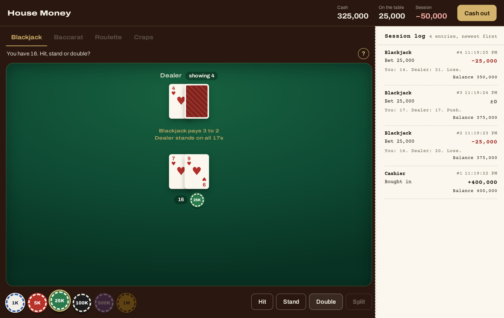
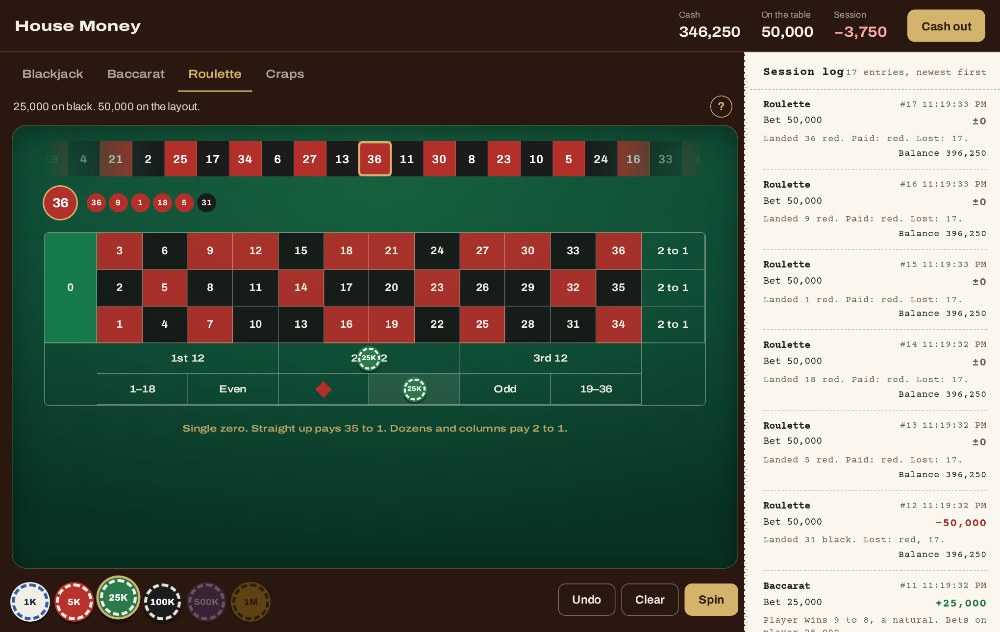
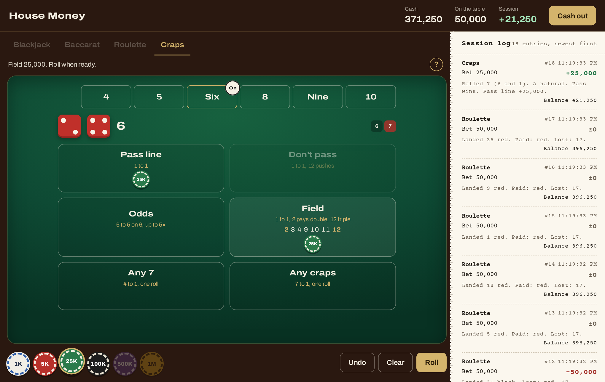
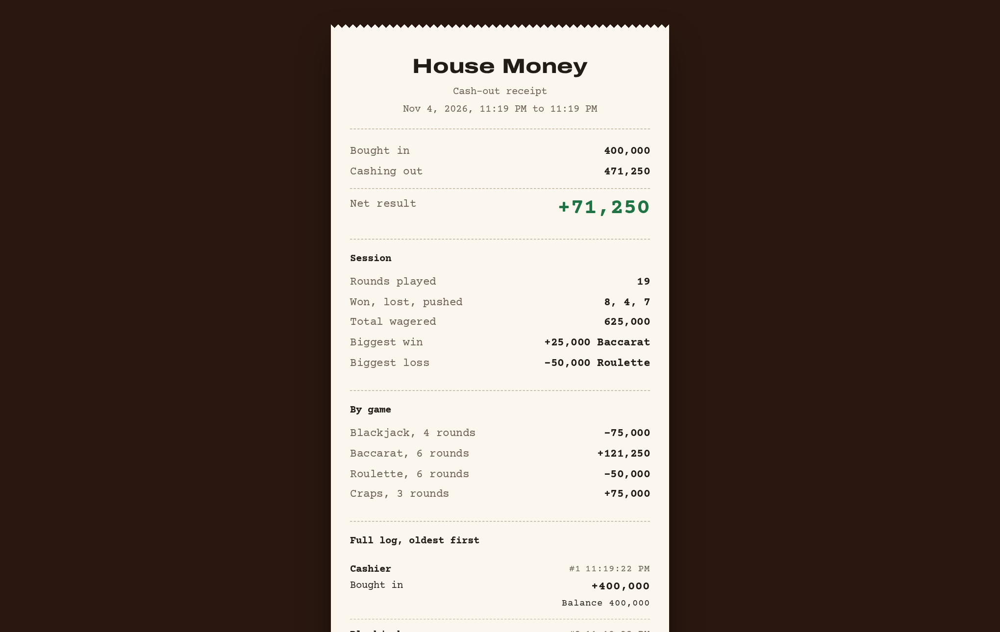
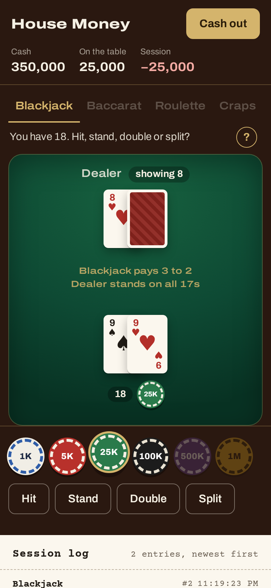

# House Money

A practice casino with play money: blackjack, baccarat, roulette and craps. No real money is involved.

**Live site:** [house.hellotulio.com](https://house.hellotulio.com/)



## Why it exists

I built House Money for an event, to give people the fun of gambling with none of the risk. Players sat down with a starting bankroll from the host and played the tables. At the end, each player showed the host their cash-out receipt, and what they finished with raised or lowered their budget for a draft auction run on [AuctionSystem](https://github.com/TulioContramaestre/auction-system-overview), my real-time auction platform.

## How the site works

There are no accounts and nothing is stored. A session lives in the browser tab from buy-in to cash-out.

1. **Buy in.** Choose a bankroll from 1,000 to 1,000,000,000 in whole thousands. You can type `400k` or `1.5m`, or pick a quick amount.
2. **Play.** Move between the four tables with the tabs, and pick a chip from 1K to 1M. Chips you can't afford are disabled. The header shows your cash, what's on the table and your result so far, and the session log records every round. Each table's ? button opens its rules and payouts, even mid-hand.
3. **Cash out.** The Cash out button is always in the header. It ends the session and prints a receipt with your buy-in, final balance, net result, rounds won, lost and pushed, total wagered, biggest win and loss, a per-game breakdown, the full log and a ledger check. You can print it, save it as a PDF or download it as text.

A few rules keep a session honest:

- **Locked rounds.** You can't switch tables or cash out during a blackjack hand, a baccarat deal or a roulette spin, or in craps while a line bet is up on a point. The Back and Forward buttons can't leave a locked table either.
- **Unplayed chips.** Chips you've placed but not played go back to your cash when you leave a table.
- **Out of chips.** When nothing is on the table and your cash can't cover the smallest chip, a banner points you to Cash out.
- **Ending a session.** Refreshing or closing the page ends the session, and the page warns you first. Opening a game or receipt URL directly lands you back at the cashier. Unknown URLs show a short "There's no table here." page.

Every screen has its own URL: `/`, `/play/<game>` and `/receipt`. No screen scrolls sideways, down to 320px wide, and the reduced-motion setting is read live, so changing it takes effect on the next deal, spin or roll.

| | |
| --- | --- |
|  |  |
|  |  |

## The games

| Game | Rules | Payouts |
| --- | --- | --- |
| Blackjack | 6 decks. Dealer stands on all 17s. Double on your first two cards, split up to 4 hands. No insurance or surrender. | Blackjack 3 to 2, other wins 1 to 1 |
| Baccarat | 8 decks. Standard third-card rules, no decisions after the deal. | Player 1 to 1, Banker 0.95 to 1, Tie 8 to 1 |
| Roulette | Single zero. Bet on numbers, dozens, columns, red or black, odd or even, and 1–18 or 19–36. | Straight up 35 to 1, dozens and columns 2 to 1, the rest 1 to 1 |
| Craps | Pass line, don't pass, odds, field, any 7 and any craps. | Line bets 1 to 1, odds at true odds up to 3×, 4× or 5×, field 1 to 1 (2 pays double, 12 triple), any 7 4 to 1, any craps 7 to 1 |

Cards, dice and the wheel use the browser's `crypto.getRandomValues` with rejection sampling, so results aren't skewed, and shoes are shuffled with Fisher-Yates.

## How it's built

It's a statically exported Next.js app (App Router, React 19, TypeScript, CSS Modules), with no server and no runtime dependencies beyond Next and React.

- **One-way layers.** Routes depend on components, components on the session, and the session on the game engines and `lib/`. ESLint enforces this, so a component can't import game logic.
- **Pure game engines.** Rules and payouts are plain TypeScript with no React or DOM, which keeps them easy to test. Components only render a view and dispatch typed actions.
- **One ledger.** Money is always an integer, and every change goes through a single ledger whose entries are sealed in an HMAC-SHA-256 chain. The receipt is built from that ledger, never from the page.
- **Testing.** Vitest covers the rules, payouts and components. Playwright plays real rounds at desktop and phone sizes, including tamper attempts. GitHub Actions runs lint, typecheck and both test suites on every push.

The site runs on Cloudflare as a Worker that only serves static assets. See [docs/DEPLOYING.md](docs/DEPLOYING.md).

## Limits

Everything runs in the browser, so the protections make cheating hard but can't make it impossible.

**What the app does:**
- **Ledger.** All money lives in a ledger with private fields and frozen entries. Each entry is sealed with an HMAC-SHA-256 chain, using a key the page can't export. At cash-out the whole chain is replayed: sequence, arithmetic and seals.
- **Rules.** Engines and the ledger check every action. Re-enabling a disabled button in the inspector doesn't let anyone bet more than their cash or act out of turn.
- **Built-ins.** The random number generator, shuffle, ledger and seal code use built-ins (`crypto`, `JSON`, `Object.freeze`, `TextEncoder` and so on) captured when the app loads.
- **The page.** Edits to the header numbers or the session log in the inspector snap back straight away. The receipt is built from the ledger, never from the page.
- **Exposure.** Nothing is exposed on `window`, and nothing is written to storage.

**What it can't stop:**
- Someone pausing the code in the debugger and changing values.
- Someone serving themselves a modified copy of the JavaScript.
- A script or extension that runs before the app and replaces built-ins first. The app doesn't freeze global prototypes, because that breaks the React and Next.js runtime.
- The seal shows the log wasn't edited after it was written in this page. It can't prove anything to anyone else, because the key never leaves the page and disappears with it.
- Event rules. Players type their own buy-in, a refresh starts a new session, and a downloaded receipt is an editable text file. That's why the host set each buy-in and checked receipts at the event.

**The upgrade path** is a server-side dealer and ledger. For example, a Cloudflare Worker (with a Durable Object per session) would shuffle, deal, validate every action, keep the ledger, and sign the receipt with a key the browser never sees. The browser would then only display what the server decides.

## How this was built

I came up with House Money, decided how it should work, and ran it with real players at an event. Claude Code wrote most of the code under my direction. [`CLAUDE.md`](CLAUDE.md) holds the architecture rules it worked from.

## Running it locally

You need Node.js 22 or newer. Wrangler, used for deploying, requires it.

```bash
npm install
npm run dev        # http://localhost:3000
```

Before you run the Playwright tests for the first time, install the browser:

```bash
npx playwright install chromium
```

### Scripts

| Script | What it does |
| --- | --- |
| `npm run dev` | Development server. |
| `npm run build` | Static export to `out/`. The fonts are downloaded at build time, so this needs internet access. |
| `npm run preview` | Serves `out/` with `serve`, the way a static host would. |
| `npm run lint` | ESLint, including the layer and security rules in `eslint.config.mjs`. |
| `npm run typecheck` | `next typegen`, then `tsc --noEmit`. |
| `npm test` | Unit and component tests (Vitest). |
| `npm run test:e2e` | Builds, serves `out/`, then runs the Playwright suite at desktop (1360×860) and phone (390×844) sizes. |
| `npm run preview:worker` | Serves `out/` at http://localhost:8787 with Cloudflare's own routing, headers and 404 handling. Run `npm run build` first. |
| `npm run deploy` | Builds, then deploys `out/` to Cloudflare with Wrangler. |

## Project layout

```
src/
  app/          routes only: buy-in, /play layout and /play/[game], receipt, 404
  components/   shared building blocks: ui, table, cards, dice, casino shell, log, buy-in, receipt
  games/        one folder per game: types, rules, engine, ui/ (plus registry.ts and registry.ui.tsx)
  session/      the session singleton and the React hooks and guards that read it
  lib/          pure TypeScript: ledger, money, cards, random, receipt, timing, security
  hooks/        generic React hooks (DOM guard, deal-animation watermark)
e2e/            Playwright specs
docs/           deployment guide and README images
```

`CLAUDE.md` has the architecture rules, how to add a game, and the code conventions.

## License

All rights reserved.
